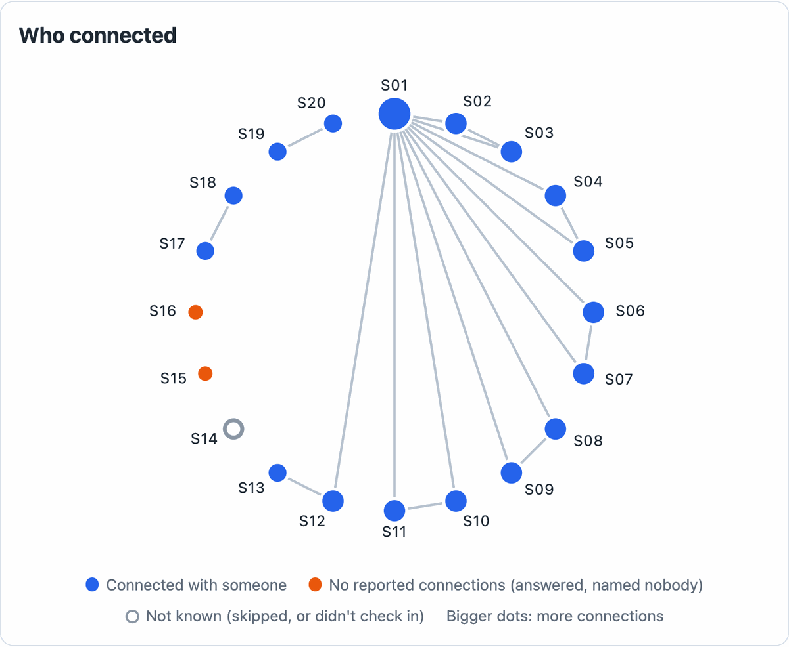
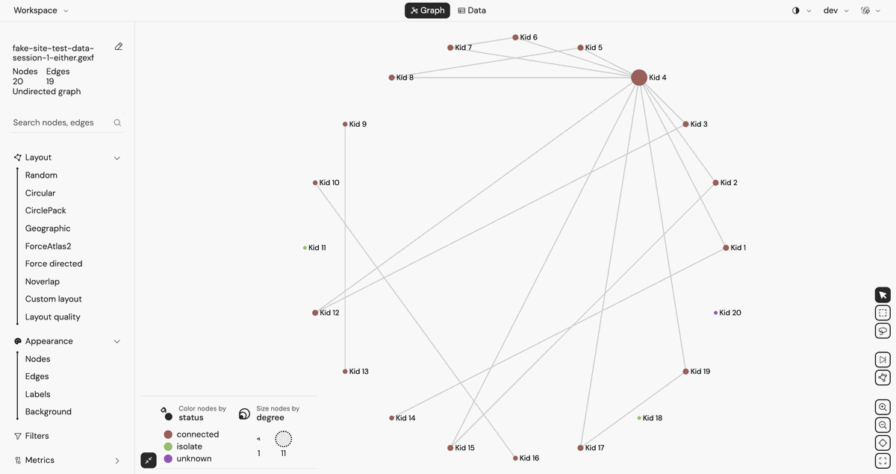

# Connected compared with Network Canvas, NetworkX and Gephi

Valente suggested checking Connected against existing tools. This covers the
three references in Irene's next-steps doc: how
[Network Canvas](https://networkcanvas.com/) asks about relationships, whether
Connected's numbers match [NetworkX](https://networkx.org/), and how to load
Connected's networks into [Gephi](https://gephi.org/) to compare the pictures.

## Question design: Network Canvas

Network Canvas is free software for collecting network data in interviews.
Its [roster name generator](https://documentation.networkcanvas.dev/en/design-protocols/interface-documentation/name-generator-roster)
shows a list of people (a roster) and the participant picks who fits each
prompt.

| | Network Canvas | Connected | Difference |
|---|---|---|---|
| Who is answering | An "identify yourself" stage: pick yourself from the roster (minimum and maximum of 1) | Tap your name on the list of kids marked as here | Same idea. Groups that can't collect names skip it |
| Naming people | One prompt per relationship, picking from a roster | One question per relationship (worked with, talked to, knew before), tapping names from the kids who are here | Same idea. Connected's roster is only the kids at that session |
| Naming nobody | Each stage can set a minimum and maximum number of people. With no minimum, a participant can move on with nobody picked, which (as far as the documentation shows) is stored the same way as not answering: no people for that prompt | A **Nobody** button. Moving on without picking anyone is recorded as a skip | Connected records the difference, so "nobody" and "skipped" never get mixed up |
| Kinds of relationship | Each prompt can make a different edge type | Worked with, talked to and knew before are kept as separate yes/no answers | Same. Connected's numbers use "worked with or talked to"; the exports keep each kind apart and labelled |
| Ties between other people | A sociogram where the participant draws ties between people they named | Not asked. Kids only report their own ties | Connected's network is built from everyone's own reports (a whole-group network), not one person's view of everyone |
| Export | CSV and GraphML files per interview | CSV report (group-level numbers) and a GEXF network file per session | Different formats; both open in Gephi |

What Connected took from this: the explicit Nobody answer (item 6 in
`docs/survey-comparison.md`), one prompt per relationship, and keeping each
relationship as its own labelled network.

## Calculations: NetworkX

`tools/public-data/` runs Connected's own `core/` code, then rebuilds every
network separately with NetworkX (from the raw ticks, and straight from the
downloaded files for the public data) and compares every number. Run it with
the commands in `tools/public-data/README.md`. Results on 23 November 2026:

| Network | People | Links (Connected / NetworkX) | Density | Centralization | Degree 0: no reported connections + unknown = NetworkX isolates | Every degree matches |
|---|---|---|---|---|---|---|
| Known answer (made up, worked out by hand) | 6 | 2 / 2 | 0.1333 / 0.1333 | 0.4000 / 0.4000 | 1 + 2 = 3 | yes |
| Known answer, talked to only | 6 | 2 / 2 | 0.1333 / 0.1333 | 0.4000 / 0.4000 | 2 + 1 = 3 | yes |
| Tiny example from docs/build-steps.md | 6 | 3 / 3 | 0.2000 / 0.2000 | 0.3000 / 0.3000 | 1 + 1 = 2 | yes |
| Fake site, session 1 | 20 | 19 / 19 | 0.1000 / 0.1000 | 0.5322 / 0.5322 | 2 + 1 = 3 | yes |
| Fake site, session 2 | 16 | 22 / 22 | 0.1833 / 0.1833 | 0.6286 / 0.6286 | 2 + 1 = 3 | yes |
| SocioPatterns 2013: friendship named in a survey | 329 | 406 / 406 | 0.0075 / 0.0075 | 0.0446 / 0.0446 | 0 + 195 = 195 | yes |
| SocioPatterns 2013: contact reported in a diary | 329 | 348 / 348 | 0.0064 / 0.0064 | 0.0303 / 0.0303 | 0 + 209 = 209 | yes |
| SocioPatterns 2013: Facebook friends (where known) | 329 | 1437 / 1437 | 0.0266 / 0.0266 | 0.1235 / 0.1235 | 0 + 173 = 173 | yes |
| SocioPatterns 2013: near each other (sensors) | 329 | 5818 / 5818 | 0.1078 / 0.1078 | 0.1584 / 0.1584 | 0 + 2 = 2 | yes |

Everything matches: number of people, links, density (`nx.density`), each
kid's number of links (`G.degree`), Freeman degree centralization worked out
from those degrees, and average links per kid. The known-answer group
(`tests/fixtures/known-answer.js`) was also worked out by hand, and
`npm test` checks Connected gets the hand-worked answers.

The public-data counts also match the published paper (Mastrandrea et al.,
2015): 327 students with sensor contacts and 5,818 contact pairs; 120
students who filled in a diary; 156 students with Facebook data and 1,437
Facebook links; and a friendship network of 134 students and 406 links. The
paper says 135 students answered the friendship survey, but only 134 appear
in the file: the student who answered without naming anyone can't be found
from the links alone. That is exactly why Connected now records "Nobody"
separately from skipping.

### Differences that are on purpose, not errors

- **Isolates.** NetworkX calls every person with no links an isolate.
  Connected splits them in two: "no reported connections" (they answered the
  who-questions, with names or Nobody, and nobody named them) and "unknown"
  (they skipped, were away, or didn't check in). The two always add up to
  NetworkX's count, as the table shows. This is why the friendship and diary
  networks have 0 "no reported connections": those files only list students
  who named someone, so a student who answered "nobody" can't be told apart
  from one who didn't answer, and Connected won't guess.
- **Direction.** Kids' reports have a direction (Ana named Ben). Connected
  links a pair if either kid named the other, which is NetworkX's
  `to_undirected()` on the reports. It doesn't measure whether ties are
  returned (reciprocity).
- **Everyone is kept.** Every kid marked as here is a node, even with no
  links, so density and averages are out of the whole group.

No calculation errors were found. The only changes were the skipped-versus-
nobody rule and the labels, which were design problems rather than maths.

## Pictures: Gephi

The group report has a **Download GEXF** button for sessions that ask who
kids worked with or talked to. Each file holds one kind of connection (worked
with or talked to, worked with, talked to, or knew before), with everyone
marked as here as a node. Kids are numbered ("Kid 1", "Kid 2", ...), never
named. Groups with leader support also get each kid's status (connected, no
reported connections, unknown) as a node attribute; group-only groups don't.
`tools/public-data/` writes the same kind of file for each SocioPatterns
relationship (`output/sociopatterns-*.gexf`).

### Checked in Gephi Lite (24 November 2026)

We used the made-up test group "Fake site (test data)" on the live site,
session 1, without changing it. We downloaded all four GEXF files from its
report and opened each one in [Gephi Lite](https://lite.gephi.org) 1.1.2, the
free version of Gephi that runs in a web browser. There we worked out each
kid's degree (number of connections), sized the dots by degree, coloured them
by status and used the **Circular** layout, so the picture looks like
Connected's. We then read the same files with NetworkX (`nx.read_gexf`) and
compared all three with Connected's results screen.

| Session 1, worked with or talked to | Connected | Gephi Lite | NetworkX |
|---|---|---|---|
| Kids (nodes) | 20 | 20 | 20 |
| Connections (edges) | 19 | 19 | 19 |
| Kids with no connections (degree 0) | 3: 2 no reported connections + 1 not known | 3 | 3 isolates |
| Most connections for one kid | 11 (S01, the biggest dot) | 11 (Kid 4) | 11 |
| Connections per kid, on average | 1.9 | 1.9 (its degree column adds up to 38, over 20 kids) | 1.9 |

The files for the other kinds of connection also matched in all three:

| Session 1 file | Kids | Connections | Degree 0 (no reported connections + not known) | Most connections |
|---|---|---|---|---|
| Worked with (`...-worked.gexf`) | 20 | 18 | 3 (2 + 1) | 10 |
| Talked to (`...-talked.gexf`) | 20 | 18 | 5 (4 + 1) | 11 |
| Knew before joining (`...-knew.gexf`) | 20 | 0 | 20 (0 + 20) | 0 |

**What matched.** Beyond the counts, we compared the networks pair by pair.
Every line in Connected's picture joins the same two kids as an edge in the
file, in Gephi Lite's edge table and in NetworkX, and every kid has the same
number of connections and the same status everywhere. The kids with no
connections are dots on their own in both pictures (S15 and S16, no reported
connections, and S14, not known, are Kid 11, Kid 18 and Kid 20 in the file),
and bigger dots mean more connections in both. The kinds stay apart: each
file holds one kind, every edge says which (`relation` is `either`, `worked`,
`talked` or `knew`), and the full wording, such as "Worked with or talked to
(either kid said so)", is in the file's description, which Gephi Lite shows
under the pencil next to the file name. The worked-with and talked-to files
together give exactly the combined file (17 pairs said both, 1 only worked
together and 1 only talked). All four files are valid GEXF 1.3, checked
against the official schema. Session 2 (16 kids, 22 connections) matched in
the same way, and the four SocioPatterns files gave the same counts in Gephi
Lite as in the NetworkX table above (329 nodes; 406, 348, 1,437 and 5,818
edges).

**What differed, and why it isn't an error.**

- **Labels.** Connected's picture shows names, because this group has leader
  support. The file never includes names, so Gephi shows "Kid 1", "Kid 2",
  ..., numbered in the order of the kids' hidden database ids: here S01 is
  Kid 4. The numbers match across one session's files, but the same kid can
  have a different number in another session.
- **Positions.** Connected goes clockwise from the top in name order. Gephi
  Lite's circle starts on the right and goes anticlockwise in file order. The
  shapes look different, but the pairs are the same.
- **Colours and sizes.** Gephi Lite picks its own colour for each status (and
  may pick different ones next time); Connected uses blue, orange and a grey
  ring. Both make dots bigger for more connections, on different scales.
- **"Mixed graph" for an empty file.** Gephi Lite guesses the kind of graph
  from the first edge, so a file with no edges shows as "Mixed graph" and its
  edge table has no `relation` column. The file says undirected, and NetworkX
  reads it that way. Here the knew-before file is empty because none of these
  made-up October check-ins has a knew-before answer, so every kid is "not
  known" rather than "knew nobody".
- **Numbers Gephi Lite doesn't have.** It has no density or centralization.
  Those are checked with NetworkX in the section above.

No errors were found in the export or the picture, so nothing in Connected
was changed.

### How to repeat it

1. On the group report, under **Network file for Gephi**, pick the kind of
   connection and press **Download GEXF**.
2. Go to [lite.gephi.org](https://lite.gephi.org). It's free, and it opens
   the file in your browser without uploading it. Choose **Open a local
   file**, pick the file and press **Open**.
3. At the top left, **Nodes** and **Edges** should match **Kids here** and
   **Connections** on the results screen (for the "worked with or talked to"
   file).
4. Choose **Metrics > Degree > Compute metric**, then the **Data** tab, and
   sort by `degree`. The kids with 0 have no connections. For groups with
   leader support, `status` says which of them answered (`isolate`, shown as
   "no reported connections" in Connected) and which are `unknown`. The
   highest degree should match the biggest dot in Connected's picture.
5. For a picture like Connected's: under **Appearance > Nodes**, set the size
   from `degree` and the colour from `status`, then choose **Layout >
   Circular > Apply**.

The Gephi desktop app (also free) works the same way: **File > Open** the
file and keep it undirected. **Statistics > Average Degree** should match
"Connections per kid, on average" and **Graph Density** should match "Share
of possible pairs who connected". Use **Layout > Circular Layout** and colour
by `status` (**Appearance > Nodes > Partition**).
